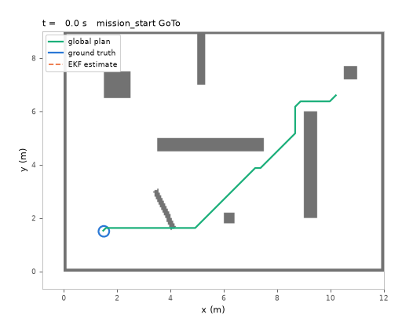

# ros2-autonomy-stack

A ROS 2 Jazzy autonomy stack, written mostly in C++, for a simulated differential-drive robot
that goes to goals, patrols and docks in a 12 x 9 m warehouse. It covers state estimation
(EKF with ICP scan matching), occupancy-grid mapping, global planning (A* and Theta*), local
control (pure pursuit and DWA) and task execution with a BehaviorTree.CPP v4 behaviour tree that
recovers when the path is blocked. Everything builds and runs headless in Docker.

## Why it's hard

- **Robust navigation means getting every layer right at once.** Odometry drifts, so the EKF has
  to fuse IMU yaw and LiDAR scan matching, and reject bad ICP matches through chi-square gates.
  The planner has to merge the prior map with live mapping to see obstacles it was never told
  about. The controller has to report "blocked" honestly, and the behaviour tree has to recover
  without fighting the controller for `/cmd_vel`.
- **The evaluation runs the real stack.** All 60 runs launch the shipped ROS nodes, not a
  re-implementation, across 2 noise levels x 2 clutter levels x 2 planners x 2 controllers x
  3 seeds, plus 12 blocked-path runs.
- **The maths is testable without ROS.** The estimator, ICP, grid, planners and controllers live
  in five ROS-free `*_core` libraries with GoogleTest suites. These also run under
  AddressSanitizer and UndefinedBehaviorSanitizer.

## Demo



The demo uses A* with pure pursuit and seed 7. After the robot has driven 2 m, a 1.6 m wall
appears 0.45 m in front of it. The behaviour tree backs up, rotates and replans, and the robot
reaches the goal. In the recorded run (`results/demo/run/summary.json`), it needed 3 recoveries
and arrived in 52.1 s, with an EKF position error (ATE RMSE) of 0.0035 m. The MCAP rosbag is in
`results/demo/run/bag/`.

To re-record it, run these commands:

```bash
rm -rf results/demo/run/bag
make demo          # runs the launch inside Docker and records the bag and CSVs
make gif           # renders docs/demo.gif on the host (needs numpy, matplotlib, pillow)
```

## Quick start

You need Docker. The native target also needs g++, CMake and Ninja.

```bash
make native-test   # ROS-free core libraries, GoogleTest under ASan + UBSan
make docker-test   # builds the image, then runs colcon test (gtests, launch_testing, pytest)
make eval          # the full experiment grid -> results/eval_runs.csv + eval_summary.md
make reproduce     # eval + demo + gif
make docker-shell  # interactive shell inside the built workspace
```

To run the full stack yourself inside `make docker-shell`:

```bash
ros2 launch autonomy_bringup navigation.launch.py planner:=thetastar controller:=dwa tree:=Patrol
```

The launch arguments are listed below.

| Argument | Options |
|---|---|
| `planner` | `astar`, `thetastar` |
| `controller` | `pure_pursuit`, `dwa` |
| `tree` | `GoTo`, `Dock`, `Patrol` |
| `noise_scale` | multiplies every sensor error |
| `clutter_count` | random boxes that are not in the prior map |
| `drop_after_m` | drops a wall in front of the robot after this distance |
| `seed` | seeds the simulator's noise |
| `rviz:=true` | opens RViz with the bundled config |
| `record_dir` / `record_bag` | records the run's CSVs and a rosbag |

## Key results

These come from `results/eval_summary.md`: 60 runs with seeds 1-3, taking 6.2 minutes of wall
time. The task is to drive from the dock at (1.5, 1.5) to (10.2, 6.6). All values are means
over each cell's runs.

**Planner x controller (12 runs each, all noise and clutter levels)**

| Planner | Controller | Success | Time to goal (s) | ATE RMSE (m) | Mean abs curvature (1/m) | Integral of curvature² (1/m) | Plan turning (rad) |
|---|---|---|---|---|---|---|---|
| A* | pure pursuit (baseline) | 12/12 | 28.9 | 0.014 | 0.60 | 6.6 | 7.33 |
| A* | DWA | 12/12 | 24.8 | 0.014 | 0.33 | 2.4 | 7.27 |
| Theta* | pure pursuit | 12/12 | 23.9 | 0.013 | 0.22 | 1.5 | 1.79 |
| Theta* | DWA | 12/12 | 23.9 | 0.012 | 0.22 | 1.4 | 1.79 |

Compared with the A* + pure pursuit baseline, Theta* + DWA:
- reached the goal 17% faster;
- had a 79% lower integral of curvature squared along the driven path;
- had 76% less heading change in the first global plan.

**Localisation across noise and clutter (12 runs each)**

ATE RMSE was:
- 0.004 m with low noise and no clutter;
- 0.024 m with 3x noise and 12 unmapped boxes.

All 48 runs reached the goal.

**Blocked-path recovery (3 runs per planner/controller pair)**

The behaviour tree ran a recovery in 11 runs. The robot reached the goal in 10 of those 11 runs
(91%).

## Limitations

- **A 2D simulator instead of Gazebo.** Gazebo needs the desktop image (several GB more), GPU or
  software rendering, and more RAM than the 7 GB available. It would also make the launch tests
  slow and flaky. The questions being evaluated are planar, so `sim2d` is enough to answer them.
  It provides a raycast LiDAR, noisy odometry and IMU, and ground truth. It does not model wheel
  slip, 3D effects or sensor latency. The stack only uses standard topics, so it could be pointed
  at Gazebo without code changes.
- **Small samples.** Each cell has between 3 and 12 runs, and the tables report means only, with
  no confidence intervals. Runs use wall-clock timers, so they cannot be reproduced bit for bit.
- **One recovery failure.** In the blocked-path run with Theta* + DWA and seed 1, all 4 attempts
  were used up. DWA kept stopping close to the dropped wall, and the 0.3 m back-up was not enough
  to break the cycle. This result is reported as measured, not tuned away (DECISIONS.md #29).
- **CI not yet run on GitHub.** `.github/workflows/ci.yml` defines a native sanitizer job and a
  colcon job in `ros:jazzy-ros-base`. It has only been exercised locally through the same
  `make` targets.

## Target roles

- **Griffin Labs (LionsBot): autonomy software.** This project covers ROS 2, localisation and
  mapping, path planning, state estimation, control loops and behaviour-tree task execution,
  with tests.
- **HTX RAUS: unmanned systems.** This project covers ROS 2, motion planning and
  simulation-based evaluation of autonomy.
- **PSA (secondary).** This project covers modular simulation components and operational logic
  in C++ and Python.

## More

- [docs/FEATURES.md](docs/FEATURES.md): tech stack and a feature-by-feature explainer.
- [docs/DESIGN.md](docs/DESIGN.md): decisions, trade-offs and the baseline vs improved comparison.
- [docs/INTERVIEW_NOTES.md](docs/INTERVIEW_NOTES.md): likely interview questions with answers.
- [RESUME_BULLETS.md](RESUME_BULLETS.md): resume bullets with measured numbers.
- [DECISIONS.md](DECISIONS.md): the full decision log.
