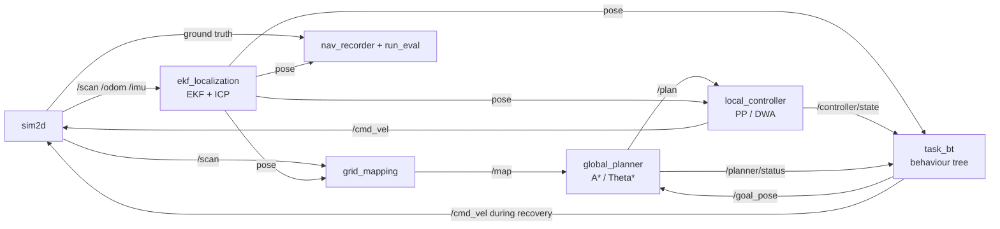

# Features

## Tech stack

| Language / framework / tool | What it is used for in this project |
|---|---|
| C++20 with rclcpp | All the ROS nodes and the five ROS-free maths libraries |
| ROS 2 Jazzy (`ros:jazzy-ros-base`) | Topics, parameters, TF, launch files and rosbag2 |
| BehaviorTree.CPP v4 | Mission logic (`GoTo`, `Dock`, `Patrol`) and recovery when blocked |
| CMake, ament_cmake and colcon | Builds the workspace. Each `*_core` package also builds as plain CMake |
| GoogleTest (`ament_cmake_gtest`) | Unit tests for the EKF, ICP, grid, planners, controllers and tree logic |
| launch_testing and pytest | Scenario tests with time and error budgets, and metric unit tests |
| AddressSanitizer and UBSan | The native run of the core-library tests (`make native-test`) |
| Python with rclpy and numpy | The run recorder, metric computation and the evaluation driver |
| matplotlib and pillow | Renders `docs/demo.gif` from the recorded CSVs, on the host |
| Docker | One image that builds, tests and runs the stack headless |
| GitHub Actions | CI with two jobs: native sanitizers, and colcon build and test |
| RViz2 | Optional visualisation (`rviz:=true`) |

## End-to-end workflow

`sim2d` publishes `/scan`, `/odom` and `/imu`, plus a ground-truth pose. `ekf_localization`
fuses the odometry and IMU yaw, and corrects the result with ICP against the prior map.
`grid_mapping` builds a live occupancy grid from the scans and the EKF pose. `task_bt` runs the
mission and sends a goal on `/goal_pose`. `global_planner` plans on the prior map merged with the
live map and publishes `/plan`. `local_controller` follows `/plan`, publishes `/cmd_vel` and
reports its state. When the controller reports that it is blocked, or the planner fails, the
behaviour tree cancels the goal and drives a recovery manoeuvre itself, then retries. For
evaluation, `nav_recorder.py` logs each run and `run_eval.py` turns the logs into metrics.

## 2D differential-drive simulator

`sim2d` loads the warehouse map and moves the true robot exactly as `/cmd_vel` commands. It
publishes three sensors: a raycast LiDAR, wheel odometry and an AHRS-style IMU yaw. The odometry
has a scale error, a yaw-rate bias and white noise, and it reads exactly zero when the wheels are
still. The simulator also publishes a ground-truth pose. If a step would make the robot overlap
an obstacle, that step is not applied. For evaluation, `noise_scale` multiplies every sensor
error, `clutter_count` adds random unmapped boxes, `drop_after_m` drops a wall in front of the
robot, and `/sim/world` publishes the true world. All randomness comes from a single seed. The
code is in `src/sim2d/src/sim2d_node.cpp`, and the noise settings are in
`src/autonomy_bringup/config/sim.yaml`.

## EKF state estimation

The filter tracks (x, y, theta). Wheel odometry velocities are its control input, and the IMU
yaw and the ICP pose are its measurements. Process noise is treated as a density, so results do
not depend on the odometry rate. Updates use the Joseph form. Chi-square innovation gates at
99.9% reject outliers such as a bad ICP match. The filter lives in
`src/ekf_core/src/ekf.cpp` and `src/ekf_core/include/ekf_core/ekf.hpp`. The ROS wrapper is
`src/ekf_localization/src/ekf_localization_node.cpp`.

## ICP scan matching against the prior map

Each scan is matched against points on the surface of obstacles in the prior map. These are the
midpoints of edges between occupied and free cells; cell centres would sit half a cell inside
the wall. The matcher implements point-to-point ICP as the baseline and point-to-line
Gauss-Newton with PCA normals as the improved version. Nearest neighbours come from a hash grid,
and a single straight wall is reported as degenerate. A match is only passed to the EKF if it
converged, its RMSE is below 5 cm and at least 50% of points are inliers. The code is in
`src/icp_core/src/icp.cpp` and `src/icp_core/include/icp_core/icp.hpp`.

## Occupancy-grid mapping

`grid_mapping` inserts each scan into a log-odds grid by Bresenham raycasting from the EKF pose.
It only uses a scan if the latest pose is within 0.1 s of the scan's stamp. Log-odds values are
clamped so that cells can change their mind. Returns at maximum range clear space but never mark
an obstacle. This is mapping with known poses, not SLAM. The grid, raycasting and loading of
map_server-style PGM/YAML maps are in `src/grid_core/src/` (`occupancy_grid.cpp`,
`bresenham.cpp` and `map_io.cpp`). The node is `src/grid_mapping/src/grid_mapping_node.cpp`.

## Global planning: A* and Theta*

A* (the baseline) searches on an 8-connected grid without cutting corners. Theta* (the improved
planner) adds any-angle shortcuts using a supercover line-of-sight test. Both use the same
best-first search, and obstacles are inflated by the robot radius. `planOnMap` handles a start
that is in collision (reported as a failure) separately from a start that is only inside the
inflation margin (it plans anyway). The planner node merges the prior map with the live map,
ignoring live hits close to known walls, and replans at 1 Hz. The code is in
`src/planning_core/src/grid_planners.cpp` and `src/planning_core/src/nav_planner.cpp`. The node
is `src/global_planner/src/global_planner_node.cpp`.

## Local control: pure pursuit and DWA

Pure pursuit (the baseline) adapts its speed to the path's curvature, slows down near the goal
and rotates in place when the path is behind the robot. DWA (the improved controller) samples
velocities inside a dynamic window set by the acceleration limits. It keeps only commands that
can brake before hitting an obstacle, and scores them on goal, heading, clearance and speed. Its
local goal is 1.0 m of arc length along the path, and its obstacles are scan endpoints. A
`StuckDetector` reports the robot as blocked in two cases: the controller commands motion but
wheel odometry shows none for 1 s, or DWA finds no admissible velocity for 1 s. The code is in
`src/control_core/src/` (`pure_pursuit.cpp`, `dwa.cpp` and `path_tracking.cpp`). The node is
`src/local_controller/src/local_controller_node.cpp`.

## Behaviour-tree task execution and recovery

`task_bt` loads `src/task_bt/trees/mission.xml`, which defines three missions: `GoTo`, `Dock`,
and `Patrol` (visit the waypoints in order, then dock). All three share one subtree,
`NavigateWithRecovery`. It runs `RetryUntilSuccessful(4)` over a `Fallback` of two branches.
The first is `NavigateTo`, which times out after 90 s. The second is `ForceFailure(Recover)`,
which backs up 0.3 m, rotates 1.57 rad and fails so that the retry replans. `/goal_pose` is
latched so that the first goal is not lost while nodes are still being discovered. The tree
logic is unit-tested with mock leaves in `src/task_bt/test/test_trees.cpp`. The node is
`src/task_bt/src/task_bt_node.cpp`.

## Launch files, parameters and RViz

`localization_mapping.launch.py` starts the simulator, the EKF and mapping.
`navigation.launch.py` starts the whole stack, and its arguments choose the planner, controller,
tree, noise, clutter and dropped wall. It can also start the recorder, record a rosbag and open
RViz. The YAML parameter files are in `src/autonomy_bringup/config/` (`sim.yaml`,
`localization.yaml` and `nav.yaml`). The warehouse map is in `src/autonomy_bringup/maps/`, and
the RViz config is `src/autonomy_bringup/config/autonomy.rviz`.

## Tests with time and error budgets

The `*_core` libraries have GoogleTest suites. They run in colcon, and they also run natively
under ASan and UBSan through the `native/CMakeLists.txt` superbuild. Three launch_testing
scenarios in `src/autonomy_bringup/test/` run the real nodes:

- `test_localization_mapping.py` checks localisation error and map size budgets.
- `test_navigation.py` checks that a goal is reached within 60 s, with ATE RMSE below 0.05 m.
- `test_recovery.py` checks that a goal is reached within 90 s after at least one recovery.

The metric code is checked by `test_nav_metrics.py`.

## Evaluation harness and metrics

`run_eval.py` launches 6 stacks at once, each on its own `ROS_DOMAIN_ID`, across the full
experiment grid. `nav_recorder.py` records the ground truth, EKF pose, plans and behaviour-tree
events for each run. `nav_metrics.py` computes these metrics:

- **ATE:** the RMSE of the EKF position against ground truth, with no alignment.
- **RPE:** the error over 1 m segments of travel.
- **Smoothness:** mean absolute curvature, and the integral of curvature squared, along the
  driven path resampled every 5 cm.
- **Plan turning:** the total heading change of the first global plan.
- **Time to goal and recovery counts.**

The outputs are `results/eval_runs.csv` and `results/eval_summary.md`. The scripts are in
`src/autonomy_bringup/scripts/`.

## Demo recording and GIF

`make demo` runs the blocked-path scenario (A* + pure pursuit, seed 7) and writes an MCAP
rosbag and CSVs to `results/demo/run/`. `make gif` then renders `docs/demo.gif` on the host with
`scripts/make_gif.py`.

## Docker and CI

The `Dockerfile` starts from `ros:jazzy-ros-base`. It installs BehaviorTree.CPP in its own layer,
then builds the workspace in Release with tests enabled. `make docker-test` runs `colcon test`
inside the image. `.github/workflows/ci.yml` mirrors this with two jobs: a native sanitizer job,
and a colcon job inside the same base image. The workflow has not yet been run on GitHub.
